# StockPilot — Inventory Management on a Production-Style DevOps Platform

**DevOps Final Capstone Project (Session 21)**
**Student:** Vibhuti Bhatnagar · **Roll No:** 24bcs10288 · **GitHub:** [vibhuti-scaler](https://github.com/vibhuti-scaler)
**Presentation:** [Google Slides](https://docs.google.com/presentation/d/1d1aqMQi88myVD5jn6G1iarj0KrjtRVwX9FPBXg37U6k/edit?usp=sharing) · **Walkthrough video:** [docs/StockPilot-walkthrough.mp4](docs/StockPilot-walkthrough.mp4) (4 min, captioned)

StockPilot is a small but realistic inventory-management SaaS: a warehouse team tracks products (SKUs),
their suppliers, reorder levels and an append-only ledger of stock movements (goods received / issued).
The application is deliberately simple; the point of the project is to show the full journey of that
application from a developer laptop to a monitored, autoscaled Kubernetes environment:

```text
Developer ──> Git/GitHub ──> GitHub Actions ──> GHCR ──> Terraform (AWS VPC + EKS) ──> Helm ──> Kubernetes
                              │  ruff + pytest                                                   │ Ingress
                              │  frontend build                                                  │ HPA
                              │  docker build (x2)                                               │ Prometheus
                              │  Trivy scan (x2)                                                 │ Grafana
                              └  push :<git-sha>                                                 └ Troubleshooting lab
```

[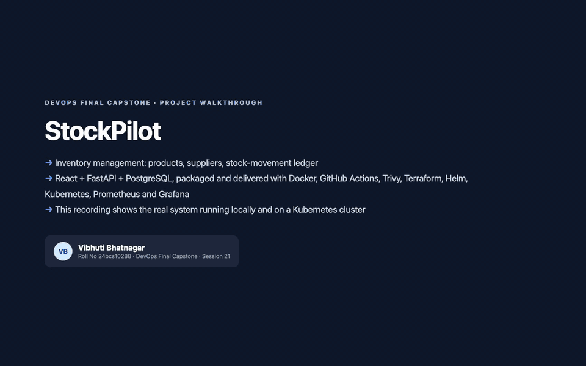](docs/StockPilot-walkthrough.mp4)

*Preview of the walkthrough video. Click it, or open [docs/StockPilot-walkthrough.mp4](docs/StockPilot-walkthrough.mp4) and use **Download** / **View raw**, for the full 4-minute captioned recording.*

---

## Table of contents

1. [Architecture](#1-architecture)
2. [Application (M1)](#2-application-m1)
3. [Testing (M2)](#3-testing-m2)
4. [Git and GitHub (M3)](#4-git-and-github-m3)
5. [Docker (M4)](#5-docker-m4)
6. [CI/CD with GitHub Actions (M5)](#6-cicd-with-github-actions-m5)
7. [DevSecOps — Trivy (M6)](#7-devsecops--trivy-m6)
8. [Terraform — AWS VPC + EKS (M7)](#8-terraform--aws-vpc--eks-m7)
9. [Kubernetes + Helm (M8)](#9-kubernetes--helm-m8)
10. [Observability — Prometheus + Grafana (M9)](#10-observability--prometheus--grafana-m9)
11. [Troubleshooting lab](#11-troubleshooting-lab)
12. [Presentation and documentation (M10)](#12-presentation-and-documentation-m10)
13. [Repository structure](#13-repository-structure)

---

## 1. Architecture

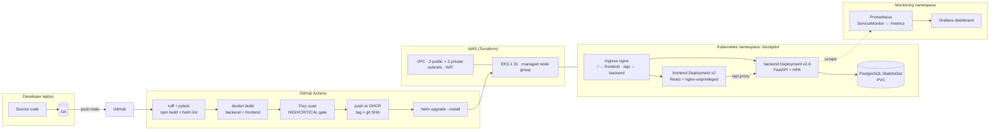

**Request path in Kubernetes:** browser → Ingress (`stockpilot.local`) → `/` goes to the frontend
Service (nginx serving the React build), `/api/*` goes straight to the backend Service (FastAPI).
Inside the frontend container nginx *also* proxies `/api` to the backend Service, so the same image works
unchanged with Docker Compose (where there is no Ingress). The backend talks to PostgreSQL through a
headless Service in front of a StatefulSet with a PersistentVolumeClaim.

| Layer | Technology |
|-------|------------|
| Frontend | React 19 + Vite 8, responsive CSS, served by `nginxinc/nginx-unprivileged` |
| Backend | Python 3.12, FastAPI, SQLAlchemy 2, Pydantic v2, Alembic migrations, `prometheus-fastapi-instrumentator` |
| Database | PostgreSQL 17 |
| Tests | pytest (28 tests), ruff lint/format |
| Containers | Multi-stage Dockerfiles, non-root users, Docker Compose |
| CI/CD | GitHub Actions → Trivy → GitHub Container Registry → Helm deploy |
| Infrastructure | Terraform 1.16, `terraform-aws-modules` VPC + EKS, offline `terraform test` suite |
| Platform | Kubernetes, Helm 3 chart, ingress-nginx, HPA + metrics-server |
| Observability | kube-prometheus-stack (Prometheus Operator, Grafana), ServiceMonitor, custom business metrics, alert rules |

---

## 2. Application (M1)

### Domain

| Entity | Purpose |
|--------|---------|
| **Product** | SKU, name, category, quantity on hand, reorder level, unit price, optional supplier. Derived `stock_status`: `IN_STOCK`, `LOW_STOCK` (≤ reorder level) or `OUT_OF_STOCK`. |
| **Supplier** | Vendor that provides products (name, contact e-mail, phone, city). Deleting a supplier detaches its products instead of deleting them. |
| **StockMovement** | Append-only ledger entry: `IN` (goods received) or `OUT` (goods issued). Creating a movement atomically updates the product quantity; issuing more than is available is rejected with `409`. |

Three tables (`suppliers`, `products`, `stock_movements`) are created by two Alembic migrations in
[backend/alembic/versions](backend/alembic/versions).

### REST API (14 endpoints)

| Method | Path | Description |
|--------|------|-------------|
| GET | `/health` | Liveness probe — process is up |
| GET | `/ready` | Readiness probe — runs `SELECT 1` against PostgreSQL, `503` if the DB is unreachable |
| GET | `/metrics` | Prometheus exposition (HTTP + business metrics) |
| GET | `/api/products` | List products; filters `?q=`, `?category=`, `?stock_status=` |
| GET | `/api/products/stats` | Dashboard KPIs (totals, low/out of stock, inventory value, movements in 24 h) |
| GET | `/api/products/low-stock` | Products at or below reorder level |
| GET | `/api/products/{id}` | Get one product |
| POST | `/api/products` | Create product (SKU normalised to upper-case, `409` on duplicate SKU) |
| PUT | `/api/products/{id}` | Partial update |
| DELETE | `/api/products/{id}` | Delete product (cascades its movements) |
| GET / POST | `/api/suppliers` | List / create suppliers |
| GET / PUT / DELETE | `/api/suppliers/{id}` | Read / update / delete a supplier |
| GET | `/api/movements` | Ledger, newest first; `?product_id=`, `?limit=` |
| POST | `/api/movements` | Receive (`IN`) or issue (`OUT`) stock |

Swagger UI is available at `/docs`:

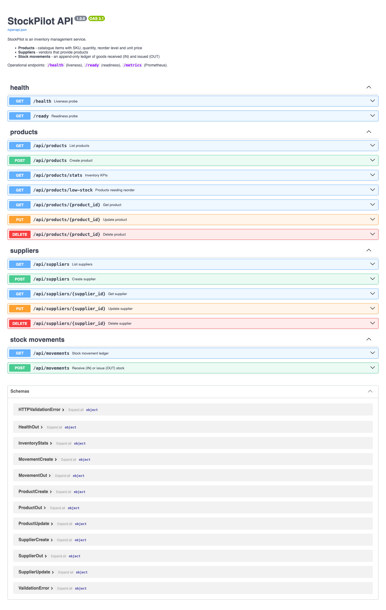

### Frontend

A single-page React dashboard with a dark sidebar, four views (Dashboard, Products, Suppliers,
Movements), KPI cards, a searchable/filterable product table with stock-level bars, a stock ledger,
create-product and receive/issue-stock modals, toast notifications, loading and backend-error states,
auto-refresh every 30 s, and a responsive layout down to phone width.

| Create product | Issue stock (OUT) |
|---|---|
| 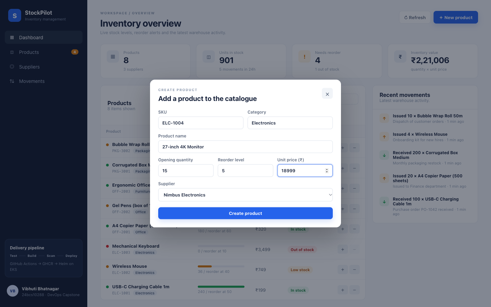 | 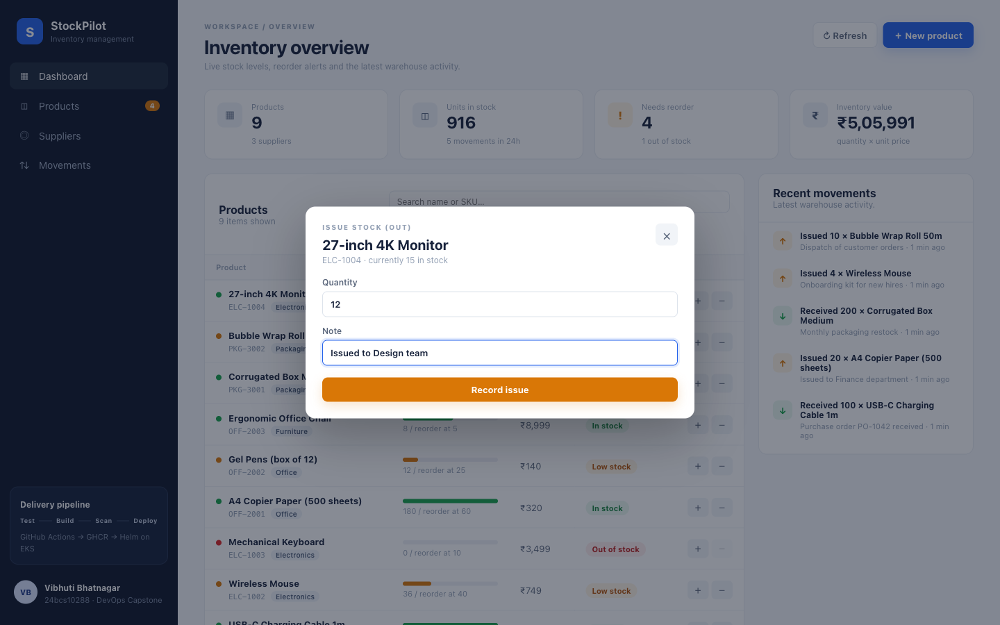 |

| Products view | Suppliers view |
|---|---|
| 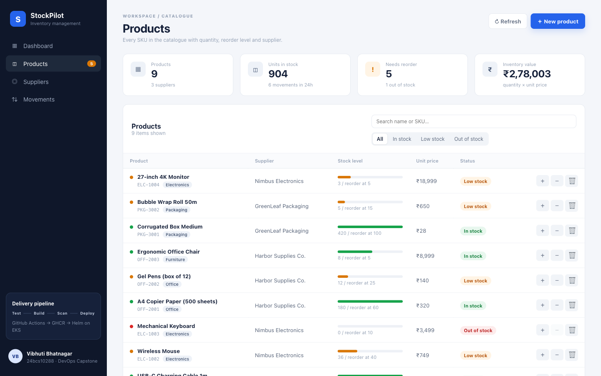 | 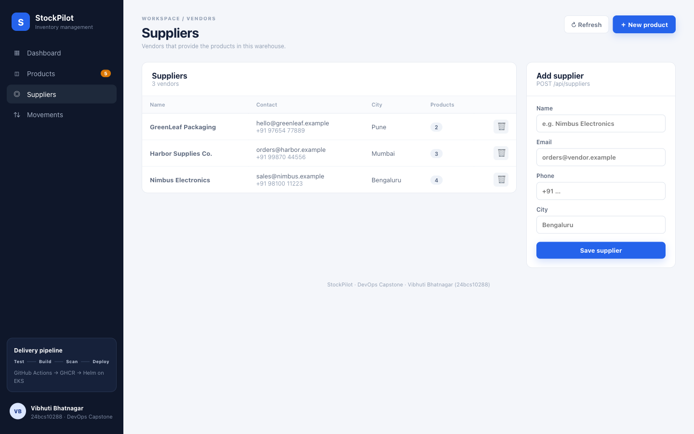 |

| Stock ledger | Mobile layout (390 px) |
|---|---|
| 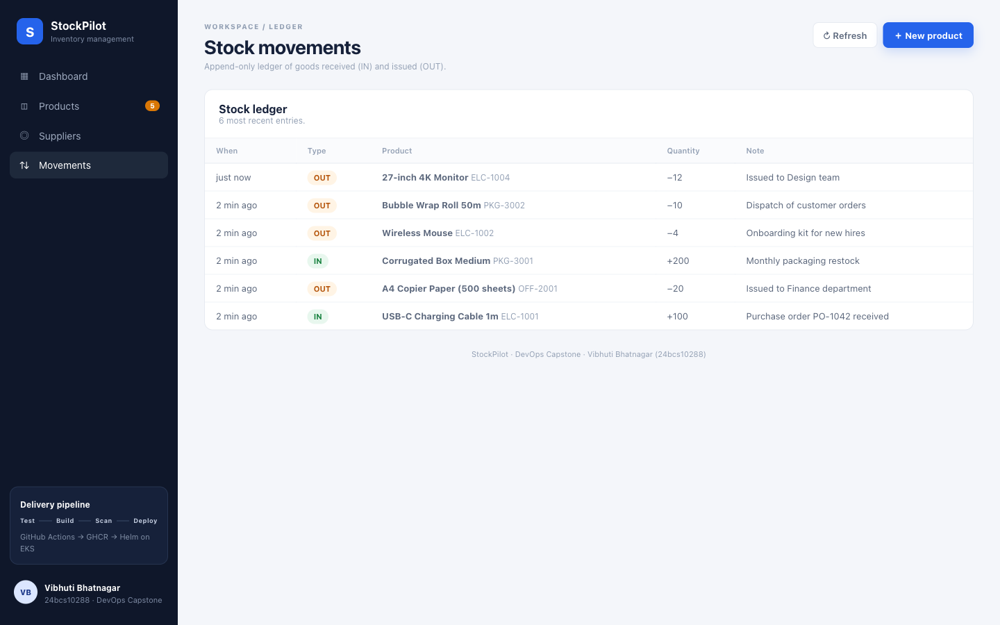 | 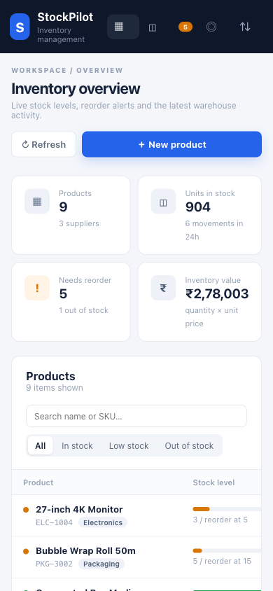 |

### Run it locally (fastest: Docker Compose)

```bash
docker compose up --build
# Frontend  http://localhost:3000
# Swagger   http://localhost:8000/docs
# Health    http://localhost:8000/health   Ready: /ready   Metrics: /metrics
docker compose down        # add -v to drop the PostgreSQL volume
```

The backend container waits for PostgreSQL, runs `alembic upgrade head`, seeds demo data when
`SEED_DEMO_DATA=true` (enabled in `docker-compose.yml`), then starts Uvicorn.

### Run the backend directly

```bash
cd backend
python3.12 -m venv .venv && source .venv/bin/activate
pip install -r requirements-dev.txt
cp .env.example .env                     # DATABASE_URL points at localhost:5432
alembic upgrade head
uvicorn app.main:app --reload --port 8000
```

```bash
cd frontend && npm install && npm run dev   # Vite dev server on :5173 proxies /api to :8000
```

PostgreSQL tables managed by Alembic (`alembic_version` is at revision `0002_stock_movements`):

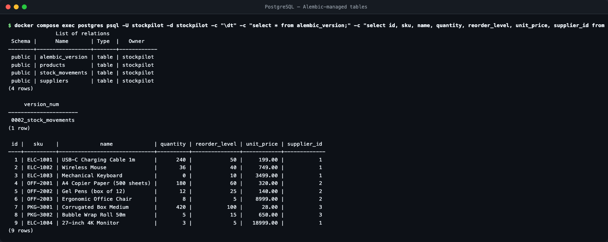

---

## 3. Testing (M2)

```bash
cd backend && pytest -v
```

* **28 test cases** across `tests/test_health.py`, `tests/test_products.py`, `tests/test_suppliers.py`
  and `tests/test_movements.py`, covering every endpoint: happy paths, validation (`422`), not-found
  (`404`), duplicate SKU (`409`), insufficient stock (`409`), filters, statistics and the `/metrics`
  exposition format.
* Tests **never touch PostgreSQL**: `tests/conftest.py` creates a fresh in-memory SQLite database for
  every test and injects it through FastAPI's `dependency_overrides`, so tests are hermetic and fast
  (the whole suite runs in ~0.2 s).
* `backend/pytest.ini` sets `pythonpath`, `testpaths` and strict markers; `backend/pyproject.toml`
  configures ruff (lint + import sorting + format) and coverage.
* Code quality gate: `ruff check . && ruff format --check .` runs before pytest both locally and in CI.

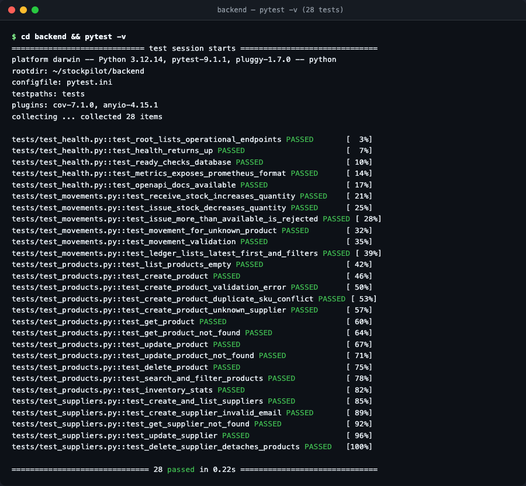

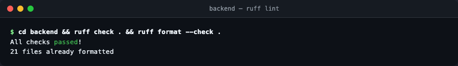

Why tests run **before** any image is built: a failing test stops the pipeline, so a broken build is
never promoted to the registry or the cluster.

---

## 4. Git and GitHub (M3)

* Repository: `https://github.com/vibhuti-scaler/stockpilot` (push with `git remote add origin git@github.com:vibhuti-scaler/stockpilot.git && git push -u origin main`).
* `.gitignore` excludes `.env`, `__pycache__/`, `node_modules/`, `.venv/`, `dist/`, Terraform state
  and `.terraform/`, `terraform.tfvars`, kubeconfigs and editor files — **no credentials are ever committed**
  (`.env.example` and `terraform.tfvars.example` document the expected variables instead).
* Commit history follows conventional, descriptive messages (`feat(backend): add stock movement ledger`,
  `ci: gate image push on Trivy scan`, …). A `.github/pull_request_template.md` and Dependabot
  configuration keep dependencies and reviews consistent.

---

## 5. Docker (M4)

| Image | Base | User | Notes |
|-------|------|------|-------|
| `stockpilot-backend` | `python:3.12-slim` (2-stage) | `app` (uid 10001) | Stage 1 builds a virtualenv from pinned `requirements.txt`; stage 2 copies only the venv + code and removes pip/setuptools, so the runtime cannot install packages. `HEALTHCHECK` on `/health`. Entrypoint runs migrations with retry, then Uvicorn. |
| `stockpilot-frontend` | `node:24-alpine` → `nginxinc/nginx-unprivileged:1.30-alpine` | `nginx` (uid 101) | Stage 1 `npm ci && npm run build`; stage 2 ships only `dist/`. nginx listens on **8080** (unprivileged), serves the SPA and proxies `/api` to `$BACKEND_URL` (templated at start-up, so the same image works in Compose and Kubernetes). |

```bash
docker build -t stockpilot-backend:local ./backend
docker build -t stockpilot-frontend:local ./frontend
docker compose up --build        # postgres + backend + frontend
```

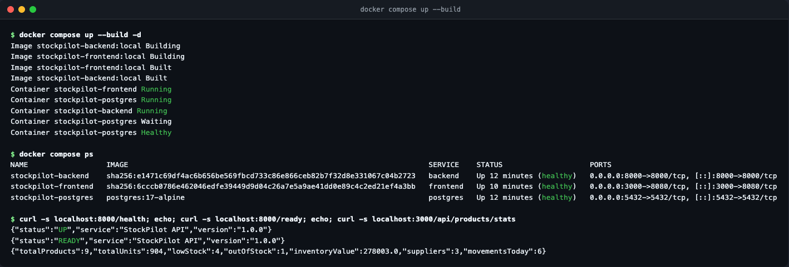

Both containers run as non-root users:

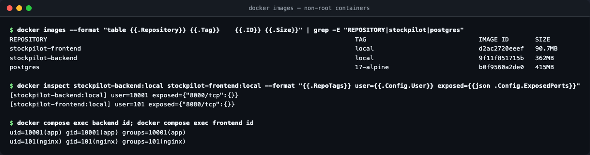

Application served from the frontend container at `http://localhost:3000` (see the dashboard screenshot
at the top and the Products view above).

---

## 6. CI/CD with GitHub Actions (M5)

Workflow: [.github/workflows/ci-cd.yml](.github/workflows/ci-cd.yml) — triggers on every **push to
`main`**, on pull requests (build + scan only, no push) and manually.

```text
┌───────────────────────────┐   ┌────────────────────────────────┐   ┌─────────────────────────┐
│ test                      │   │ build-scan-push                │   │ deploy (main only)      │
│  ruff check + format      │──>│  docker build backend/frontend │──>│  helm upgrade --install │
│  pytest -v --cov          │   │  trivy image (HIGH,CRITICAL)   │   │   --set backend.tag=SHA │
│  npm ci && npm run build  │   │  push ghcr.io/...:<git-sha>    │   │   --set frontend.tag=SHA│
│  helm lint + template     │   │  push ghcr.io/...:sha-<short>  │   │  kubectl rollout status │
└───────────────────────────┘   └────────────────────────────────┘   └─────────────────────────┘
```

Key properties:

* **Tests gate the build** — `build-scan-push` has `needs: test`; a failing test fails the run.
* **Both images** are built with Buildx and GitHub Actions cache.
* **Image tag = Git commit SHA** (`ghcr.io/<owner>/stockpilot-backend:<sha>`), plus a short `sha-xxxxxxx`
  alias. No mutable `latest` is pushed, so every running Pod can be traced back to one commit.
* **Trivy must pass** (exit code 1 on HIGH/CRITICAL) before `docker push`.
* **Deploy** installs Helm, decodes the `KUBE_CONFIG_DATA` secret (base64 kubeconfig of the EKS cluster),
  creates the namespace and a GHCR pull secret, runs `helm upgrade --install` with `values-prod.yaml`
  and waits for the rollout. If the secret is not configured the job prints a warning and skips, so
  the pipeline stays green for forks/classrooms without a cluster.
* Pull requests run test + build + scan but never push or deploy.

Secrets/variables used: `GITHUB_TOKEN` (automatic, for GHCR), `KUBE_CONFIG_DATA` (repository secret),
`INGRESS_HOST` (repository variable, optional).

> After pushing to GitHub, the Actions run URL and the GHCR package pages
> (`https://github.com/vibhuti-scaler?tab=packages`) are the evidence for this module.

---

## 7. DevSecOps — Trivy (M6)

Trivy scans **both** container images in the pipeline (`aquasecurity/trivy-action`) with
`severity: HIGH,CRITICAL`, `ignore-unfixed: true` and `exit-code: 1`, so any fixable HIGH/CRITICAL CVE
fails the job before the image reaches GHCR. A SARIF report is also uploaded to the GitHub Security tab.

The same scan run locally against the images built from this repository:

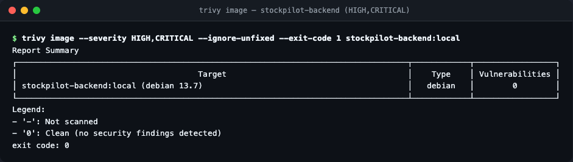
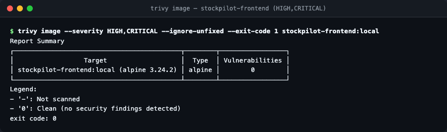

**What Trivy scanned and what the result means.** Trivy inspected the OS package database of each image
(Debian 13 for the backend, Alpine 3.24 for the frontend) and the application dependency metadata
(Python `dist-info` in the backend virtualenv). The result is clean: 0 HIGH/CRITICAL vulnerabilities with an
available fix. The first scan of the backend *did* report four HIGH findings — `setuptools` 70.3.0
(CVE-2025-47273, path traversal) and `urllib3`/`msgpack` vendored inside `pip` — none of which came from
the application's own requirements but from the installer tooling bundled in the `python:3.12-slim`
base image. The fix was to make the backend image multi-stage and strip pip/setuptools from the runtime
stage, which both removed the CVEs and reduced the attack surface. "Clean" means no *known, fixable*
HIGH/CRITICAL CVE at scan time; Trivy is one automated control, not a guarantee.

---

## 8. Terraform — AWS VPC + EKS (M7)

[terraform/](terraform/) provisions the production environment (region `ap-south-1`):

* **VPC** `10.20.0.0/16` with **two public subnets** (`10.20.101.0/24`, `10.20.102.0/24`) and two private
  subnets across `ap-south-1a`/`ap-south-1b`, Internet Gateway, single NAT Gateway, ELB discovery tags.
* **EKS 1.31** control plane with public endpoint, cluster-creator admin access, add-ons (CoreDNS,
  kube-proxy, VPC CNI, Pod Identity agent, EBS CSI driver with an IRSA role for PVCs).
* **Managed node group** `general`: `t3.medium`, min 2 / desired 2 / max 4, in the private subnets.
* Variables with validation, `locals` for naming/tags, outputs including the `aws eks update-kubeconfig`
  command, `terraform.tfvars.example` with **no credentials**, optional S3 remote-state block.
* **Offline test-suite** `terraform/tests/plan.tftest.hcl`: `terraform test` plans the whole stack with a
  **mocked AWS provider** (no credentials, no cost) and asserts 2 public + 2 private subnets, one NAT
  gateway, the node group and that a single-AZ configuration is rejected.

```bash
cd terraform
terraform init
terraform fmt -check -recursive && terraform validate
terraform test                 # mocked provider, 3 runs pass
terraform plan -out=tfplan     # needs AWS credentials (aws configure / AWS_PROFILE)
terraform apply tfplan
aws eks update-kubeconfig --region ap-south-1 --name stockpilot-eks
terraform destroy              # ALWAYS after the evaluation - EKS + NAT cost money per hour
```

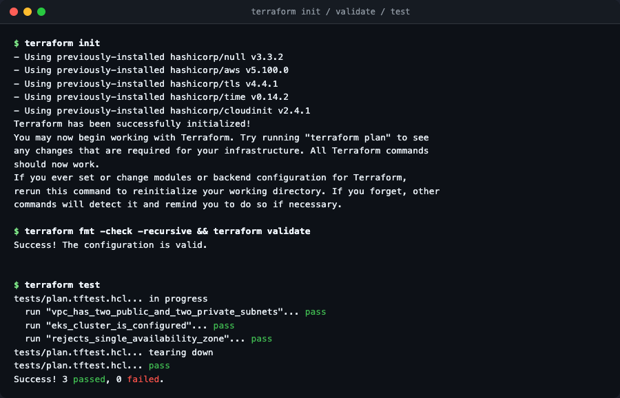

The plan produced by the mocked provider (identical resource graph to a real `terraform plan`;
67 resources to add):

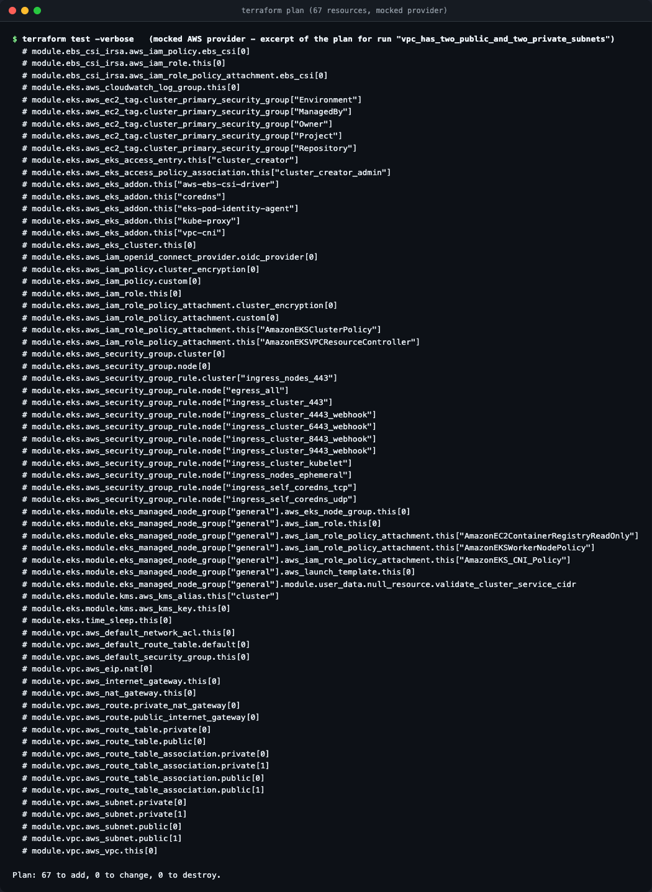

> The AWS Console screenshots (VPC + EKS) and the `terraform destroy` completion output are produced
> when the stack is applied with real credentials; the exact commands are in
> [terraform/README.md](terraform/README.md).

---

## 9. Kubernetes + Helm (M8)

* [k8s/namespace.yaml](k8s/namespace.yaml) — the `stockpilot` namespace (with a baseline Pod Security label).
* [helm/stockpilot](helm/stockpilot) — the chart:

| Template | Object |
|----------|--------|
| `backend-deployment.yaml` / `backend-service.yaml` / `backend-configmap.yaml` | FastAPI Deployment (2 replicas, probes on `/ready` and `/health`, resource requests/limits, non-root security context, `DATABASE_URL` assembled from a Secret) + ClusterIP Service `:8000` |
| `frontend-deployment.yaml` / `frontend-service.yaml` | nginx Deployment (2 replicas, `BACKEND_URL` env → backend Service) + ClusterIP Service `:80 → 8080` |
| `postgres-secret.yaml` / `postgres-statefulset.yaml` | Secret, headless Service, StatefulSet with a `volumeClaimTemplate` (`postgres.enabled=false` switches to an external/RDS host) |
| `ingress.yaml` | `ingressClassName: nginx`; `/api`, `/docs`, `/openapi.json` → backend, `/` → frontend |
| `hpa.yaml` | `autoscaling/v2` HPA on backend CPU (60 %), 2–6 replicas |
| `servicemonitor.yaml` | Prometheus Operator `ServiceMonitor` scraping `/metrics` every 15 s |
| `tests/test-connection.yaml` | `helm test` Pod that curls health, readiness and the API through both Services |
| `NOTES.txt`, `_helpers.tpl` | Post-install notes, standard `app.kubernetes.io/*` labels |

Value files: `values.yaml` (defaults, GHCR images), `values-dev.yaml` (local cluster, `stockpilot.local`),
`values-kind.yaml` (the kind lab used below), `values-prod.yaml` (EKS, gp2 storage, production host).

```bash
kubectl apply -f k8s/namespace.yaml
helm lint helm/stockpilot
helm upgrade --install stockpilot ./helm/stockpilot -n stockpilot -f helm/stockpilot/values-dev.yaml
helm list -n stockpilot
helm test stockpilot -n stockpilot
kubectl get pods,svc,ingress,hpa -n stockpilot
```

### Local cluster lab (kind)

`scripts/kind-up.sh` creates a 3-node kind cluster (ports 80/443 mapped), installs ingress-nginx,
metrics-server and kube-prometheus-stack, builds and loads the two images and deploys the chart with
`values-kind.yaml`. Everything below was captured from that cluster.

`kubectl get pods -n stockpilot` — backend ×2, frontend ×2, PostgreSQL, all `Running`:

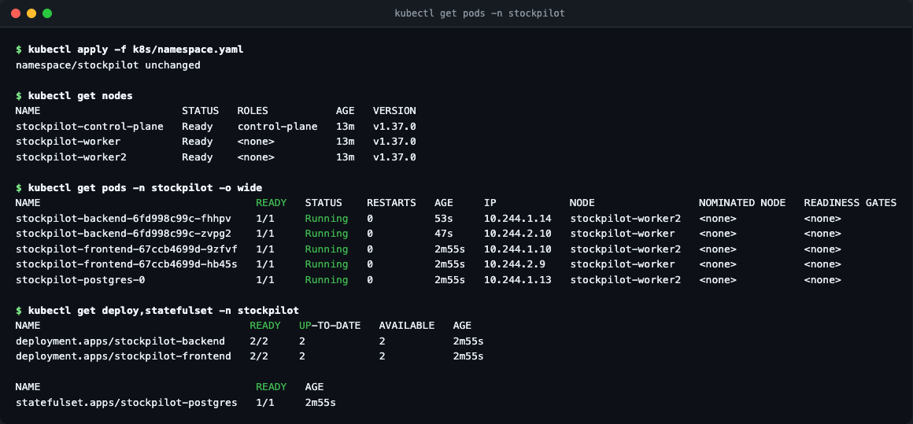

`kubectl get svc,ingress,hpa -n stockpilot` — ClusterIP Services for backend and frontend, the Ingress and the HPA:

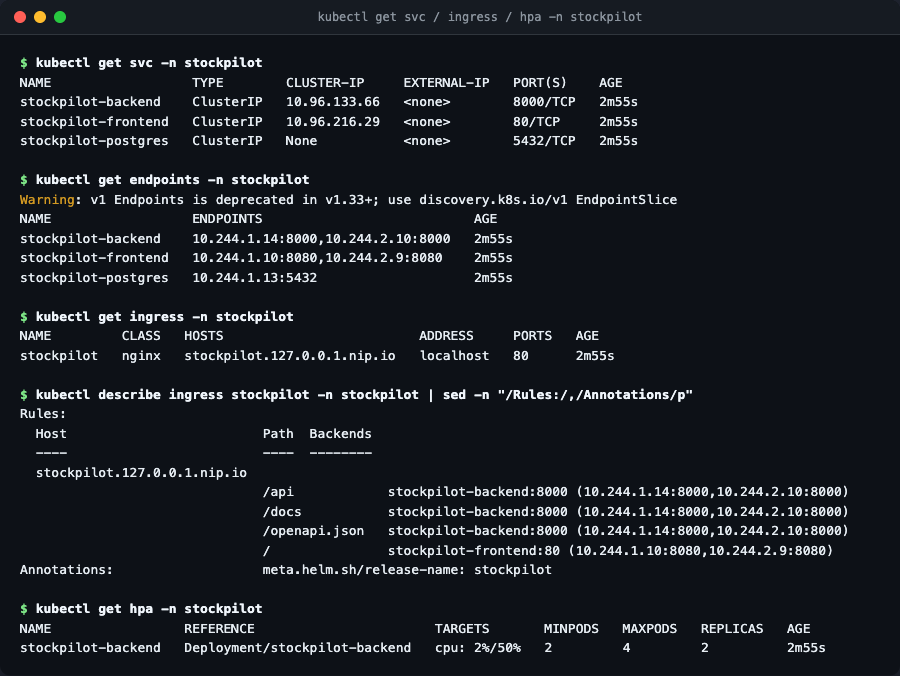

`helm list` and `helm test`:

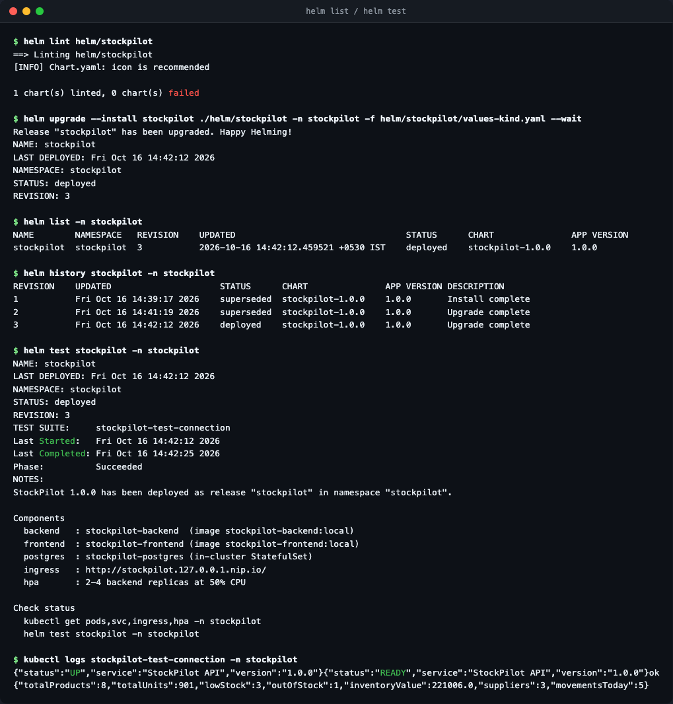

### Ingress

The Ingress routes `/` to the frontend and `/api` to the backend on the host `stockpilot.local`
(`values-dev.yaml`; add `127.0.0.1 stockpilot.local` to `/etc/hosts`) or, without any hosts entry,
`stockpilot.127.0.0.1.nip.io` (`values-kind.yaml`). The application opened through the Ingress hostname:

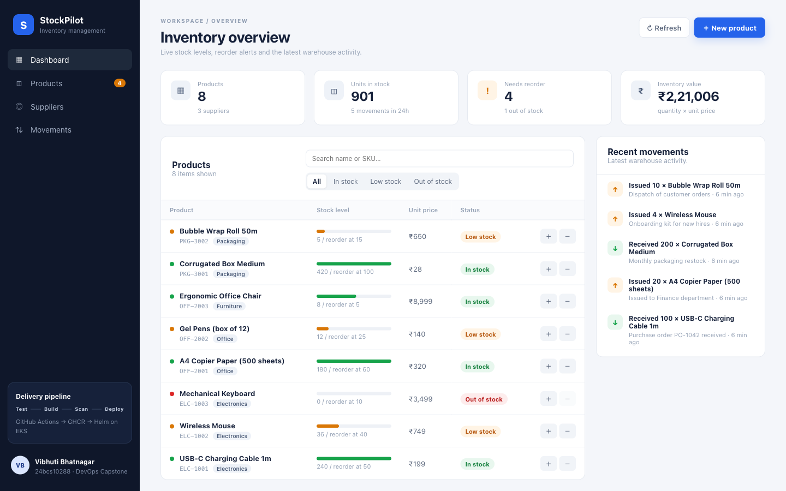

### Horizontal Pod Autoscaler

The HPA targets 50–60 % CPU on the backend Deployment (requests `100m`). `scripts/load-test.sh`
hammers `/api/products` with 20 concurrent workers; metrics-server reports the CPU and the HPA scales
the backend from 2 towards the maximum:

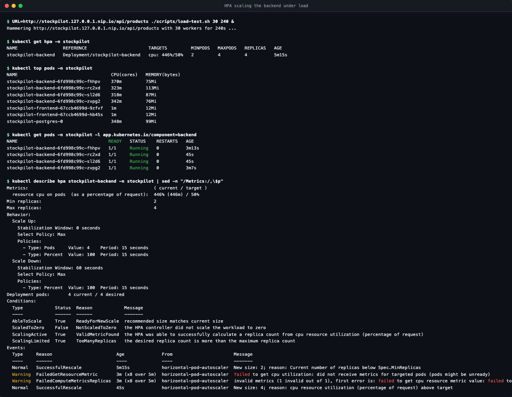

---

## 10. Observability — Prometheus + Grafana (M9)

* The backend exposes Prometheus metrics on `/metrics`: `http_requests_total{handler,method,status}`,
  `http_request_duration_seconds` histograms, request/response sizes, plus custom business metrics
  `stockpilot_products_total`, `stockpilot_low_stock_products`, `stockpilot_inventory_value` and
  `stockpilot_stock_movements_total{movement_type}`.

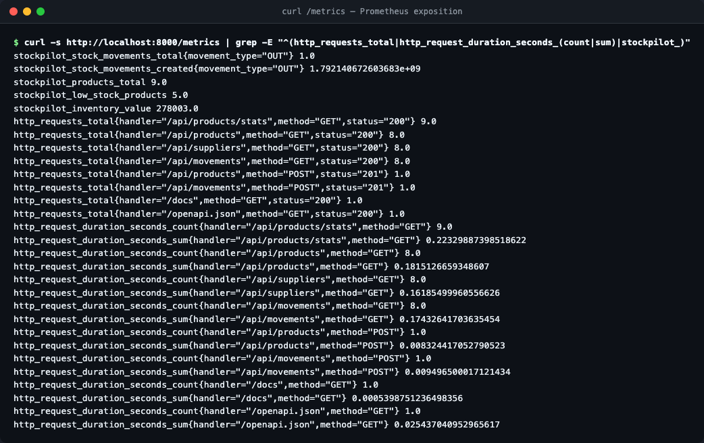

* [monitoring/kube-prometheus-stack-values.yaml](monitoring/kube-prometheus-stack-values.yaml) installs
  Prometheus Operator + Prometheus + Alertmanager + Grafana and lets Prometheus discover
  `ServiceMonitor`s from every namespace. The chart's `ServiceMonitor` registers the backend, which shows up
  as `UP` on the Prometheus Targets page:

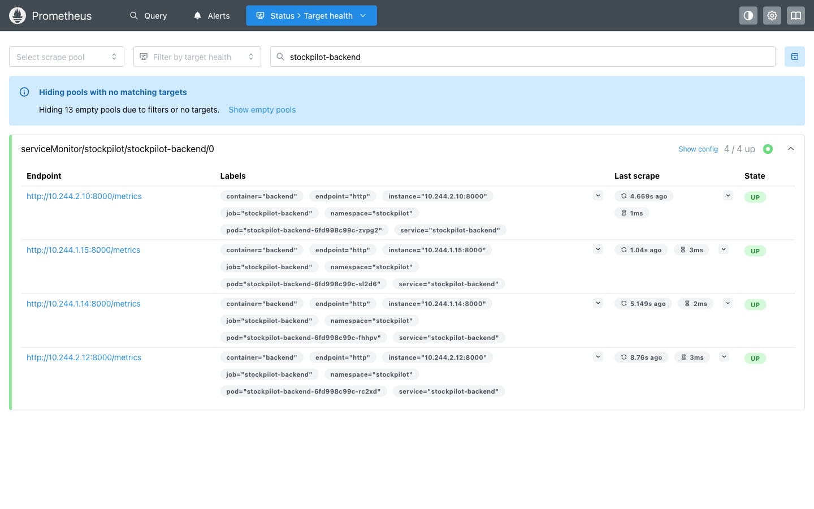

* [monitoring/grafana-dashboard-configmap.yaml](monitoring/grafana-dashboard-configmap.yaml) provisions the
  "StockPilot — Application Overview" dashboard automatically through the Grafana sidecar (request rate,
  p50/p95/p99 latency, 5xx ratio, responses by status, movements per minute, backend CPU vs HPA target,
  replicas, inventory value). [monitoring/stockpilot-alert-rules.yaml](monitoring/stockpilot-alert-rules.yaml)
  adds alerting rules for backend down, error rate, latency and reorder backlog.

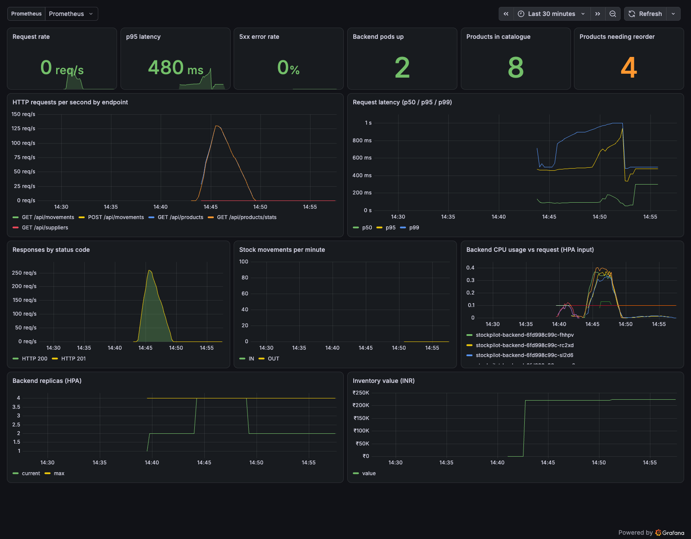

```bash
helm repo add prometheus-community https://prometheus-community.github.io/helm-charts
helm upgrade --install kube-prometheus-stack prometheus-community/kube-prometheus-stack \
  -n monitoring --create-namespace -f monitoring/kube-prometheus-stack-values.yaml
kubectl apply -f monitoring/grafana-dashboard-configmap.yaml -f monitoring/stockpilot-alert-rules.yaml
kubectl port-forward -n monitoring svc/kube-prometheus-stack-prometheus 9090:9090
kubectl port-forward -n monitoring svc/kube-prometheus-stack-grafana 3001:80     # admin / stockpilot
```

---

## 11. Troubleshooting lab

[troubleshooting/](troubleshooting/) contains three deliberately broken manifests and a
[walkthrough](troubleshooting/README.md):

| Scenario | Symptom | Root cause → fix |
|----------|---------|------------------|
| `broken-image.yaml` | `ImagePullBackOff` | non-existent image tag → `kubectl describe pod` shows the failed pull; point the Deployment at a valid tag |
| `broken-service.yaml` | Service has `<none>` endpoints | selector label typo → compare with `kubectl get pods --show-labels`, patch the selector, endpoints appear |
| `broken-probe.yaml` | `CrashLoopBackOff` | wrong database host → `kubectl logs` shows the DNS error; fix `DATABASE_URL` |

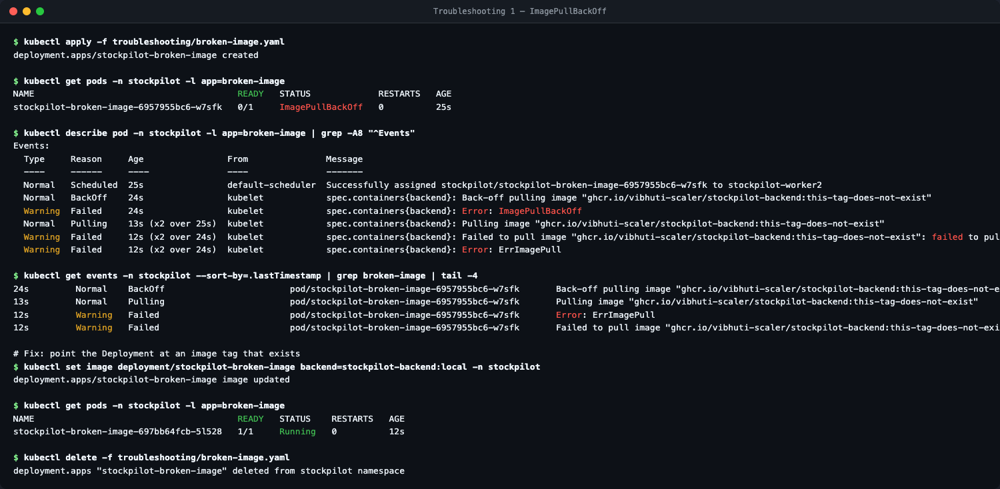
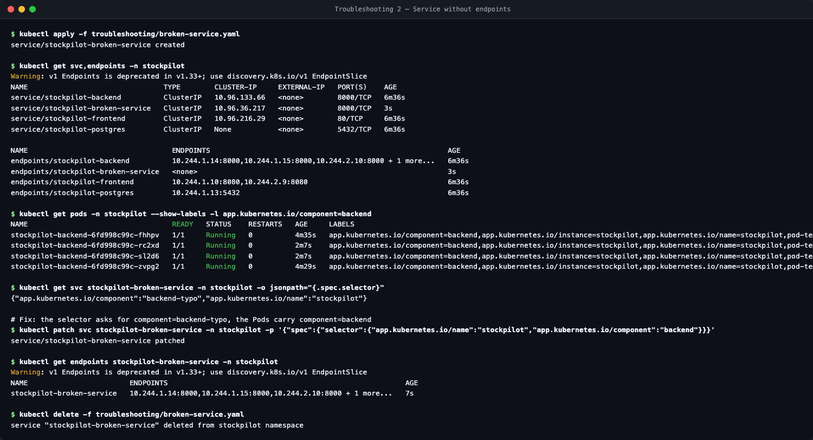
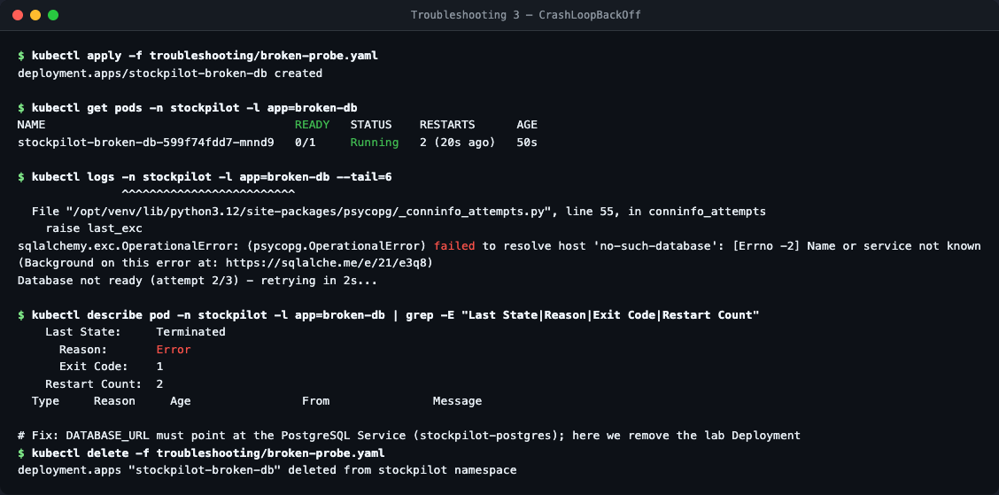

---

## 12. Presentation and documentation (M10)

The slide deck for the presentation is on [Google Slides](https://docs.google.com/presentation/d/1d1aqMQi88myVD5jn6G1iarj0KrjtRVwX9FPBXg37U6k/edit?usp=sharing)
(application, API, testing, Docker, CI/CD, Trivy, Terraform, Kubernetes/Helm, Ingress/HPA, observability,
troubleshooting, demo flow).

A recorded walkthrough of the running system (dashboard, creating a product and issuing stock, Swagger, tests,
Compose, Trivy, CI workflow, Terraform, Helm, the kind cluster through its Ingress, HPA scaling, Prometheus targets,
the Grafana dashboard and the three troubleshooting scenarios) is in
[docs/StockPilot-walkthrough.mp4](docs/StockPilot-walkthrough.mp4) (4 min 10 s, 1440×900, captions on screen).
An animated preview is shown at the top of this README:

[](docs/StockPilot-walkthrough.mp4)

Demo order used in the live presentation: application → API (Swagger) → database → Git commit → CI pipeline →
Docker images → Trivy scan → GHCR → Terraform → Kubernetes → Helm → Ingress → HPA → Prometheus/Grafana →
failure simulation (troubleshooting lab).

---

## 13. Repository structure

```text
.
├── backend/                     FastAPI application
│   ├── app/                     config, db, models, schemas, metrics, routers/, seed
│   ├── alembic/versions/        0001_suppliers_products.py, 0002_stock_movements.py
│   ├── tests/                   conftest.py + 28 tests
│   ├── Dockerfile               multi-stage, non-root, pip removed from runtime
│   ├── entrypoint.sh            wait-for-db → alembic upgrade head → (seed) → uvicorn
│   ├── requirements.txt / requirements-dev.txt / pytest.ini / pyproject.toml / .env.example
├── frontend/                    React + Vite dashboard
│   ├── src/                     App.jsx, api.js, styles.css, components/
│   ├── nginx/default.conf.template
│   └── Dockerfile               node build stage → nginx-unprivileged runtime
├── docker-compose.yml           postgres + backend + frontend
├── .github/workflows/ci-cd.yml  test → build/scan/push → deploy
├── terraform/                   VPC + EKS (+ tests/plan.tftest.hcl, README)
├── k8s/namespace.yaml           namespace bootstrap
├── helm/stockpilot/             Helm chart + values-dev / values-kind / values-prod
├── monitoring/                  kube-prometheus-stack values, Grafana dashboard, alert rules
├── troubleshooting/             broken manifests + walkthrough
├── scripts/                     kind-up.sh, kind-down.sh, kind-config.yaml, load-test.sh, seed.sh
└── docs/                        screenshots/, StockPilot-walkthrough.mp4, StockPilot-walkthrough-preview.gif
```
